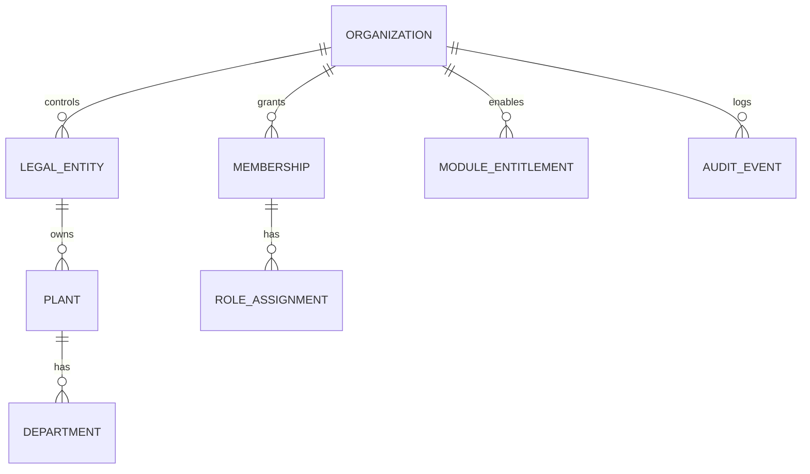
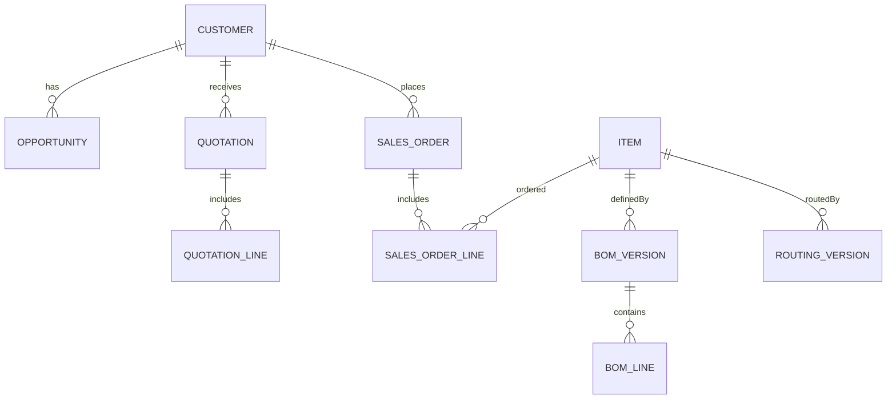
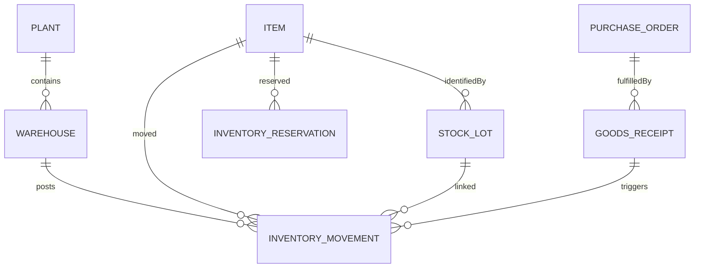
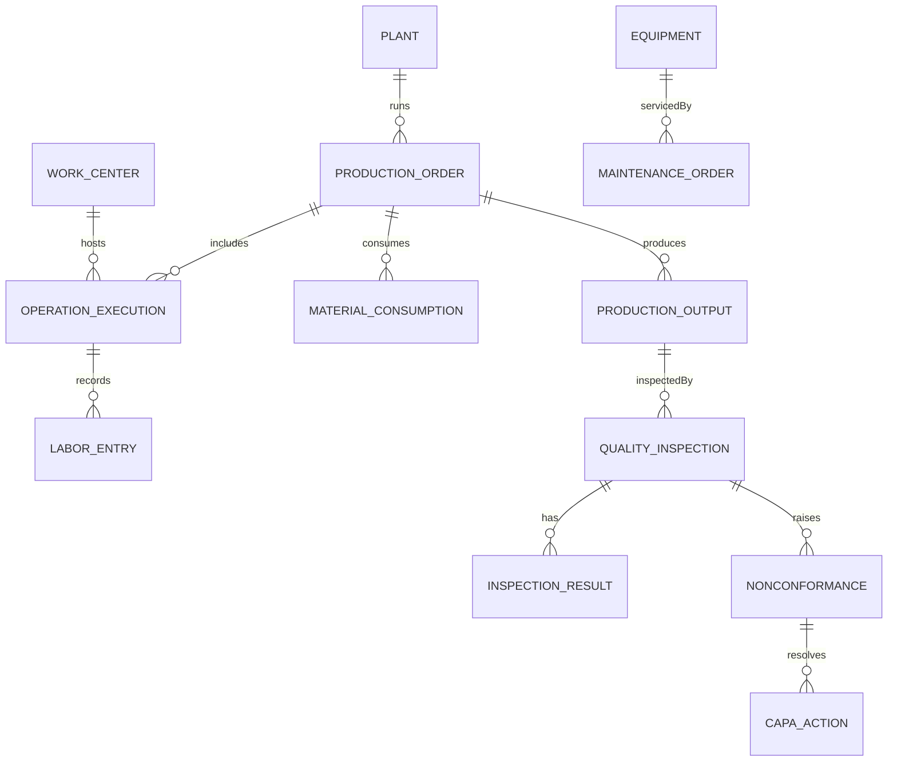
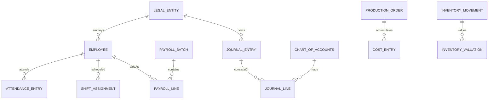
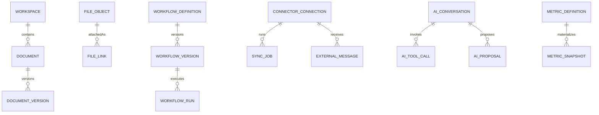

# NewSystem — Detailed ERD & Data Dictionary v1.0

**Reference:** NewSystem Master PRD v1.0 | **Date:** 10 Oktober 2026 | **Status:** Conceptual/logical schema, not production DDL.

## 1. Architecture and non-negotiable invariants
PostgreSQL modular-monolith baseline. Shared DB is not shared ownership: each domain owns writes. Cross-domain references use stable UUIDs and policy-checked API/query contracts; foreign keys are enforced inside ownership boundaries and cross-context references are checked at command layer or through replicated read models. Database physical schema, partitions, and accounting policy require technical review before migration.

Every tenant business row carries tenant_id/organization_id (except global platform metadata); legal entity scope determines financial books and payroll; plant scope determines operations. Use bigint/numeric for monetary and quantity arithmetic, never binary floating point. Times stored UTC with explicit plant timezone. Include created_at, updated_at, created_by, row_version, source_system where applicable.

## 2. Conceptual ER diagrams (editable Mermaid)

### ERD-01: Core


### ERD-02: Crm To Erp


### ERD-03: Inventory


### ERD-04: Production Quality


### ERD-05: Hris Finance


### ERD-06: Workspace Ai


## Context: CORE — Organization, roles and tenancy

| Entity/table | Required fields (not exhaustive) | Key constraints and rules |
|---|---|---|
| `organization` | `id, name, status` | UNIQUE(slug); tenant root |
| `legal_entity` | `id, organization_id, company_name, currency, tax_country` | FK organization; accounting boundary |
| `plant` | `id, legal_entity_id, code, timezone, mode_config` | UNIQUE(entity_id,code) |
| `department` | `id, plant_id, parent_id, code` | recursive tree |
| `membership` | `id, organization_id, user_id, employment_ref` | UNIQUE(org,user) |
| `role_assignment` | `id, membership_id, role_id, scope_type, scope_id` | scope-bound grants |
| `permission_policy` | `id, organization_id, resource, action, rule_version` | explicit deny overrides grants |
| `module_entitlement` | `id, organization_id, module_code, plan_code, effective_from` | dependency validation |
| `audit_event` | `id, organization_id, actor_id, resource, action, occurred_at` | append only |

## Context: CRM — Customer-to-order

| Entity/table | Required fields (not exhaustive) | Key constraints and rules |
|---|---|---|
| `customer` | `id, organization_id, legal_entity_id, account_code` | tenant-scoped customer |
| `contact` | `id, customer_id, email, role` | PII access policy |
| `lead` | `id, customer_id?, owner_id, source, status` | customer nullable until conversion |
| `opportunity` | `id, customer_id, stage, amount, probability` | pipeline stages versioned |
| `quotation` | `id, customer_id, version, status, currency` | immutable approved version |
| `quotation_line` | `id, quotation_id, item_id, qty, unit_price` | FK quotation |
| `sales_order` | `id, quotation_id?, customer_id, entity_id, version, status` | unique official number |
| `sales_order_line` | `id, sales_order_id, item_id, qty, promised_date` | allocation by line |
| `customer_case` | `id, customer_id, order_ref?, status, severity` | tickets and RMA link |

## Context: ERP — Planning, procurement and warehouse

| Entity/table | Required fields (not exhaustive) | Key constraints and rules |
|---|---|---|
| `item` | `id, organization_id, sku, kind, base_uom` | unique SKU tenant |
| `item_uom_conversion` | `id, item_id, from_uom, to_uom, factor` | factor > 0 |
| `bom_version` | `id, item_id, version, status, effective_from` | approved snapshot |
| `bom_line` | `id, bom_version_id, component_item_id, qty, scrap_pct` | qty > 0 |
| `routing_version` | `id, item_id, version, status` | approved routing |
| `routing_operation` | `id, routing_version_id, work_center_type, sequence, standard_time` | unique sequence by routing |
| `warehouse` | `id, plant_id, code, type` | UNIQUE(plant,code) |
| `stock_lot` | `id, item_id, lot_no, expiry_at?, qms_status` | expiry optional |
| `stock_balance` | `id, warehouse_id, item_id, lot_id?, quantity` | derived/materialized only |
| `inventory_movement` | `id, tenant_id, item_id, lot_id?, from_location?, to_location?, qty, txn_id` | append-only posted ledger |
| `inventory_reservation` | `id, demand_ref, item_id, lot_id?, qty, status` | cannot exceed allocatable stock |
| `purchase_request` | `id, entity_id, requestor, status` | approved policy |
| `purchase_order` | `id, entity_id, supplier_id, status, version` | official sequence |
| `goods_receipt` | `id, purchase_order_id, warehouse_id, received_at` | no stock until posted |

## Context: MES — Production execution

| Entity/table | Required fields (not exhaustive) | Key constraints and rules |
|---|---|---|
| `production_order` | `id, plant_id, item_id, plan_qty, status, bom_snapshot, routing_snapshot` | snapshot on release |
| `work_center` | `id, plant_id, code, capacity_group` | capacity calendar |
| `operation_execution` | `id, work_order_id, routing_operation_ref, work_center_id, status, good_qty, reject_qty` | qty >=0 |
| `labor_entry` | `id, operation_id, employee_id, start_at, end_at, labor_minutes` | link to HRIS identity |
| `material_consumption` | `id, work_order_id, movement_id, item_id, lot_id, qty` | FK inventory movement |
| `production_output` | `id, work_order_id, item_id, lot_id, qty, candidate_status` | QMS gate before available |
| `equipment_downtime` | `id, equipment_id, operation_id?, begin_at, end_at?, reason` | time validity |

## Context: QMS_CMMS — Quality & maintenance

| Entity/table | Required fields (not exhaustive) | Key constraints and rules |
|---|---|---|
| `inspection_plan` | `id, item_id, revision, inspection_type, acceptance_rule` | versioned plan |
| `quality_inspection` | `id, plant_id, lot_ref, source_ref, status, inspector_id` | independent disposition |
| `inspection_result` | `id, inspection_id, characteristic, observed_value, passed` | tolerance bound |
| `quality_hold` | `id, item_id, lot_id, qty, placed_by, status` | locks inventory allocation |
| `nonconformance` | `id, plant_id, source_ref, severity, status` | traceable NCR |
| `capa_action` | `id, ncr_id, owner, due_at, effectiveness_status` | approval and follow-up |
| `equipment` | `id, plant_id, code, work_center_id?, condition` | unique plant equipment code |
| `maintenance_order` | `id, equipment_id, type, status, released_by` | safety release required |
| `maintenance_part` | `id, maintenance_order_id, movement_ref, qty` | inventory link |

## Context: HRIS — People & payroll

| Entity/table | Required fields (not exhaustive) | Key constraints and rules |
|---|---|---|
| `employee` | `id, entity_id, employee_no, status, pii_ref` | restricted PII |
| `employment_contract` | `id, employee_id, version, effective_from, pay_grade_ref` | restricted |
| `shift_definition` | `id, plant_id, code, starts_at, ends_at` | timezone aware |
| `shift_assignment` | `id, employee_id, shift_id, scheduled_date, status` | competence check |
| `attendance_entry` | `id, employee_id, clock_in, clock_out, source` | approval for edit |
| `leave_request` | `id, employee_id, leave_type, status, days` | balance policy |
| `overtime_request` | `id, employee_id, shift_ref, minutes, approval_id` | approved minutes |
| `payroll_batch` | `id, entity_id, period, status, journal_ref?` | no silent recalc after finalized |
| `payroll_line` | `id, batch_id, employee_id, gross, deductions, net` | restricted; masked reporting |
| `competency_record` | `id, employee_id, competency_code, expires_at` | eligibility to work center |

## Context: ACCOUNTING — Financial system of record

| Entity/table | Required fields (not exhaustive) | Key constraints and rules |
|---|---|---|
| `chart_of_accounts` | `id, entity_id, code, account_type, active` | unique COA code entity |
| `fiscal_period` | `id, entity_id, starts_at, ends_at, locked` | closed prevents posting |
| `journal_entry` | `id, entity_id, period_id, status, source_ref, posted_at` | unique source posting |
| `journal_line` | `id, journal_id, account_id, debit, credit, cost_center_id` | sum debit=sum credit |
| `ar_invoice` | `id, sales_order_id?, entity_id, status, due_at, version` | unique invoice number |
| `ap_bill` | `id, purchase_order_id?, supplier_id, status` | 3-way-match |
| `payment` | `id, entity_id, account_id, amount, state` | bank reconcile |
| `inventory_valuation` | `id, movement_id, item_id, value, valuation_method` | reconcile to GL |
| `cost_entry` | `id, work_order_id, cost_type, source_ref, amount` | planned/actual/final status |
| `fixed_asset` | `id, entity_id, cost, depreciation_policy` | period close policy |
| `tax_document` | `id, entity_id, invoice_ref, external_status` | official provider integration |

## Context: WORKSPACE_CONNECT — Documents, automation & external systems

| Entity/table | Required fields (not exhaustive) | Key constraints and rules |
|---|---|---|
| `workspace` | `id, organization_id, scope_type, scope_id` | ACL shared/personal |
| `document` | `id, workspace_id, business_ref?, classification, status` | authoritative document key |
| `document_version` | `id, document_id, version_no, object_key, checksum, final_flag` | final version immutable |
| `file_object` | `id, tenant_id, storage_backend, object_key, mime_type, scan_status` | ACL required |
| `file_link` | `id, file_id, resource_type, resource_id` | cross-domain pointer |
| `workflow_definition` | `id, organization_id, name, latest_version` | version controlled |
| `workflow_version` | `id, definition_id, version, published_at?, config` | validated schema |
| `workflow_run` | `id, workflow_version_id, correlation_id, status` | retry/idempotent |
| `approval_request` | `id, resource_ref, approver_scope, status` | SoD check |
| `connector_connection` | `id, tenant_id, provider, scopes, secret_ref, status` | secrets outside DB |
| `sync_job` | `id, connection_id, cursor_ref?, status, retry_count` | checkpoint/duplicate defense |
| `external_message` | `id, connection_id, provider_message_id, thread_ref, safe_content_ref` | untrusted by default |

## Context: AI_ANALYTICS — Business intelligence and controlled AI

| Entity/table | Required fields (not exhaustive) | Key constraints and rules |
|---|---|---|
| `metric_definition` | `id, tenant_id, code, formula_version, grain` | governed semantic layer |
| `metric_snapshot` | `id, metric_id, scope_ref, as_of_at, value, source_watermark` | explicit data freshness |
| `knowledge_index_ref` | `id, source_file_id, acl_version, indexed_at` | retrieval permission check |
| `ai_conversation` | `id, tenant_id, user_id, scope_json, retention_policy` | scoped access |
| `ai_tool_call` | `id, conversation_id, tool, policy_decision, result_ref` | audit and SoD |
| `ai_proposal` | `id, conversation_id, command_type, payload_hash, risk_tier, status` | approved execution only |
| `forecast_run` | `id, metric_id, model_version, training_window, error_metric` | baseline comparison |
| `integration_outbox` | `id, producer_domain, aggregate_id, event_type, event_id, committed_at` | atomic outbox |
| `integration_inbox` | `id, consumer_domain, event_id, processed_at` | UNIQUE(consumer,event_id) |

## 3. Shared keys, references and cardinality
- `organization_id` is the tenant partition boundary. A `legal_entity_id` belongs to exactly one organization; a plant belongs to one legal entity in a given effective period.
- Document attachment uses `file_link(resource_type, resource_id)` plus application-level validation; no unsafe cross-tenant references.
- Production order has `bom_snapshot_id` and `routing_snapshot_id` (or embedded immutable snapshots) to avoid retroactive changes.
- Source references on financial postings include `source_type + source_id + source_line_id + posting_rule_version`, with uniqueness preventing duplicate source posting.
- Lots can be consumed into multiple output lots and output lots can use multiple input lots: maintain a dedicated `lot_genealogy_edge(input_lot_id, output_lot_id, quantity, conversion_process_ref)` for N:M traceability.
- Where `stock_balance` exists, treat as derived/materialized state; stock ledger is authoritative. Use serialized movements or inventory availability locks for concurrent reservations.
- Separate planned vs actual vs reconciled cost snapshots and never present provisional value as final.

## 4. Ledger and posting rules
| Ledger / store | Immutable entry | Reconciliation |
|---|---|---|
| Inventory movement | Signed quantity per item/lot/location/source | Location on-hand = sum movements; holds/reservations separate |
| Manufacturing costing | Cost source + allocation basis + revision | Work order cost and inventory valuation bridge |
| Journal | Balanced debit/credit lines; currency/fx/period | Debits = credits at journal, entity and period |
| Workflow execution | State transitions, retry, attempts | One logical job and at-most-one business mutation |
| Document versions | Binary hash + approved metadata | Finalized version byte hash stable |
| AI action ledger | Proposal, approval, typed tool, execution receipt | Action ties to approving human and business record |

## 5. Critical constraints / indexes
```sql
-- Schematic; adapt schema names, partial indexes and permissions before execution.
CREATE UNIQUE INDEX ux_inbox_event ON integration_inbox(consumer_domain, event_id);
CREATE UNIQUE INDEX ux_business_idempotency ON command_receipt(organization_id, domain_code, idempotency_key);
CREATE UNIQUE INDEX ux_item_sku ON item(organization_id, sku);
CREATE UNIQUE INDEX ux_plant_code ON plant(legal_entity_id, code);
CREATE UNIQUE INDEX ux_document_version ON document_version(document_id, version_no);
-- Revenue / PO / payroll official number unique by legal entity + fiscal scope.
-- CHECK(quantity >= 0) on operation reports, reservations and QC portions where applicable.
-- CHECK(debit >= 0 AND credit >= 0) on GL journal lines; sum debits/credits in atomic posting routine.
```

## 6. Deletion, retention and privacy
Soft deletion only for non-posted reference records; legal and financial records use policy-controlled retention and reversals. Payroll PII encryption and scoped access, audit and break-glass workflow. External file deletion must not invalidate official archived byte snapshot and checksum. For tenant deletion and portability, define export and legal hold prerequisites.

## 7. Transaction boundary guidelines
- ERP Inventory: stock posting atomic with quantity ledger and outbox record.
- Accounting: journal posting atomic with journal lines, source uniqueness and outbox.
- MES: operation completion and material issue may need distinct verified commands; do not assume distributed atomicity.
- Workflow/AI: never directly update another domain's tables; send typed authorized commands.
- Analytics: consume domain events with watermark, data freshness and reconciliation queries.

## 8. Recommended migration and test plan
1. Create core tenant + company/plant and RBAC schemas with tenant isolation tests.
2. Create shared item/UOM and CRM order schemas.
3. Implement inventory and financial ledger constraints before any UX bulk mutation.
4. Implement MES production snapshots/lot genealogy and QMS disposition.
5. Introduce HR payroll and accounting clearing reconciliation tests.
6. Introduce DMS/Connect/Automation and idempotent outbox workers.
7. Introduce AI/BI semantic read models with row-level/attribute-level authorization and red-team tests.

## 9. Open design decisions
- PostgreSQL RLS + app RBAC combined policy design and DB role separation.
- Lot/serial allocation grain per vertical and intercompany inventory ownership.
- Costing policy (weighted average, FIFO, standard cost variance), valuation timing and overhead rates.
- Consolidation multi-currency and legal entity tax reporting policy.
