# NewSystem — Detailed UML Specification v1.0

**Reference:** NewSystem Master PRD v1.0 | **Date:** 10 Oktober 2026 | **Status:** Pre-implementation design, subject to architecture sign-off.

## 1. Design intent & notation
UML here is a modeling contract, not executable code. Diagrams use editable Mermaid syntax. Commands mutate the owning domain; events announce committed changes; queries are permission-filtered. All state transitions are server-authoritative. Trace IDs and tenant/entity/plant scopes must propagate end-to-end.

## 2. Use-case catalogue
| ID | Actor | Use case | Owning suites | Security / invariant |
|---|---|---|---|---|
| UC-01 | Owner/CEO | Choose company/plant and view consolidated KPIs | Core, BI | Scope-filtered KPIs only; finance data by legal entity |
| UC-02 | Tenant Admin | Activate industry pack, production mode, and module entitlement | Core | Prerequisites met before activation |
| UC-03 | Sales | Create quotation, request ATP/CTP, confirm order | CRM, ERP | Confirmation reserves approved commercial version |
| UC-04 | PPIC | Net material requirements and release work orders | ERP, MES | BOM/routing snapshot immutable after release |
| UC-05 | Purchasing | Create PR, approve RFQ comparison, issue PO | ERP, Workflow | Maker-checker and spending limits |
| UC-06 | Warehouse | Receive, put away, reserve, transfer and issue lots | ERP Inventory | Posting exactly-once by idempotency key |
| UC-07 | Operator | Start/pause/complete assigned job card | MES | Only assigned plant/work center; duplicate output rejected |
| UC-08 | QC Inspector | Inspect, hold, reject, release/rework | QMS | No shipment of held stock; SoD release |
| UC-09 | Maintenance | Record breakdown, repair, test, release equipment | Maintenance | Safe machine release approval |
| UC-10 | HR Manager | Manage employment/shift/leave/payroll | HRIS | Confidential PII separated from MES |
| UC-11 | Finance | 3-way-match AP, post GL, AR, close periods | Accounting | Balanced journals, locked periods immutable |
| UC-12 | Department Admin | Configure workflow rules/forms and publish versions | Automation | Simulate + approve before activation |
| UC-13 | Employee | Create or upload business documents/files | Workspace | DMS ACL, malware scan, versioning |
| UC-14 | Document Approver | Approve and finalize official document | Workspace | Final version immutable; authority check |
| UC-15 | Integration Admin | Authorize email/Drive/OneDrive and map fields | Connect | Least-privilege OAuth; health/audit |
| UC-16 | Module Copilot User | Ask, analyze, simulate, create drafts | AI | Permission-aware retrieval and tool use |
| UC-17 | CEO/Authorized Manager | Ask Company Copilot for cross-suite diagnosis | AI, BI | Entity scope, data freshness, auditable evidence |
| UC-18 | Platform Ops | Provision tenant, monitor platform health | Control Center | No default tenant business-data access |

### UML actor-to-domain view
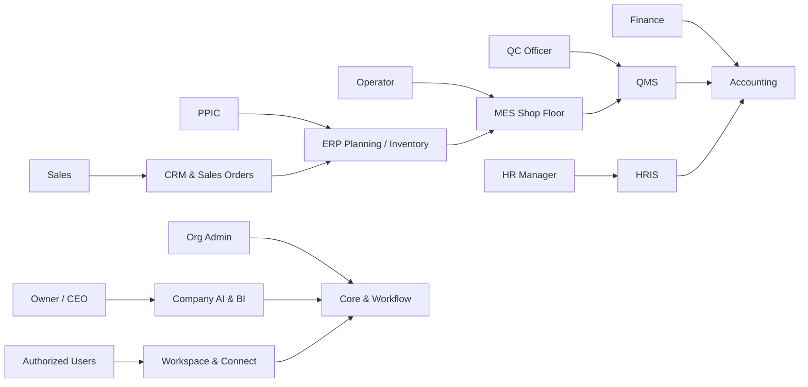

## 3. Key UML class / aggregate diagram
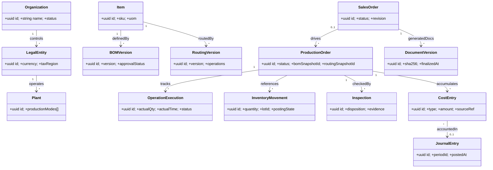

## 4. State models and guarded transitions
Each transition requires explicit actor permission, expected resource version, validation, and audit. An event is published only after persistence succeeds.

### 4.1 Sales Order
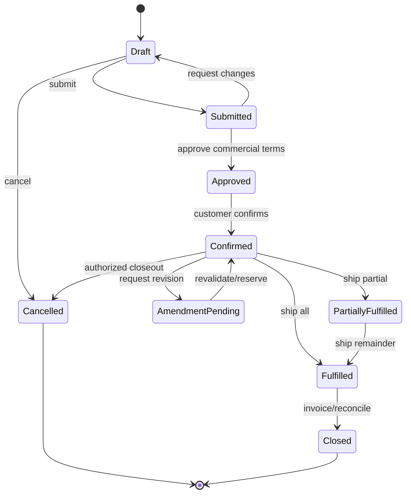

### 4.2 Purchase Order
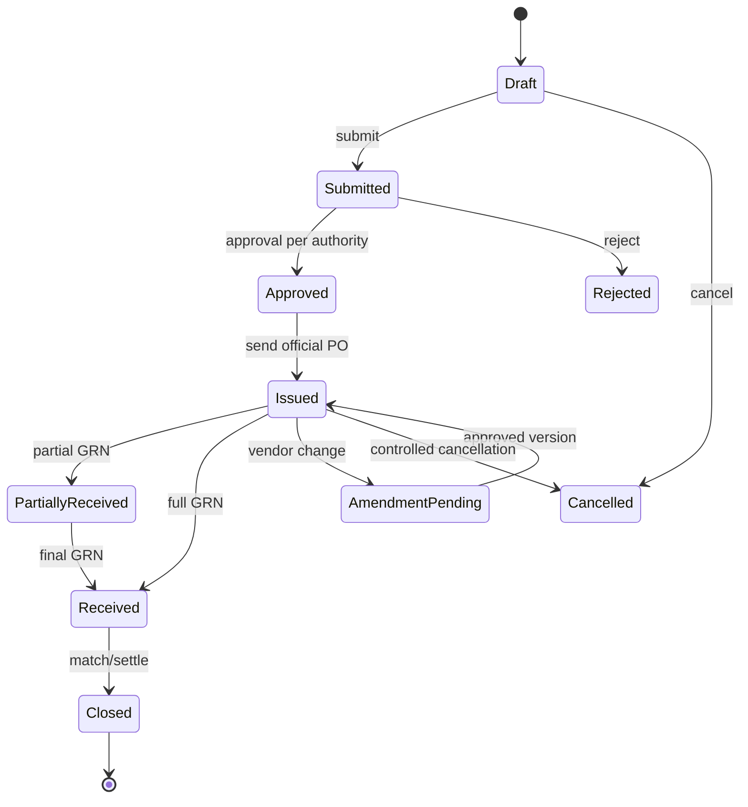

### 4.3 Production Order
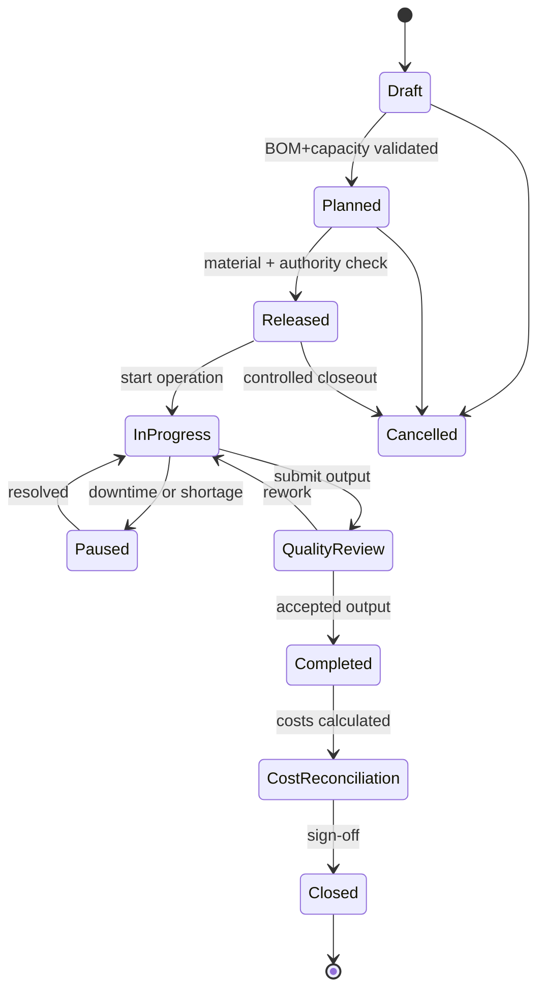

### 4.4 Invoice
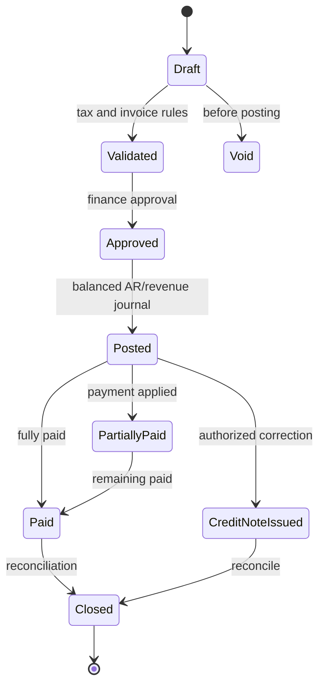

### 4.5 Workflow Version
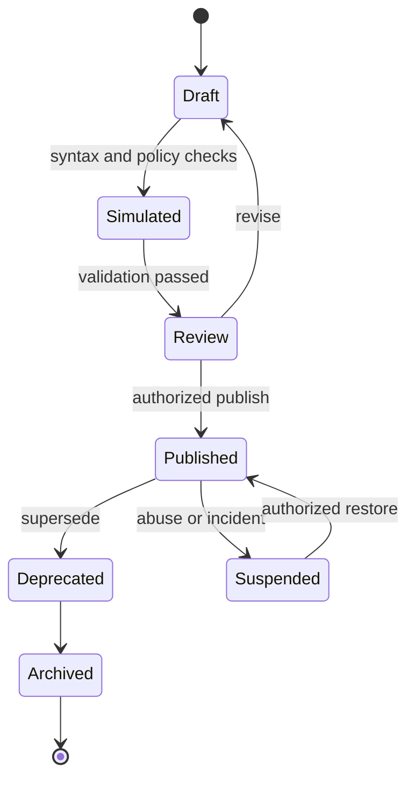

### 4.6 Official Document
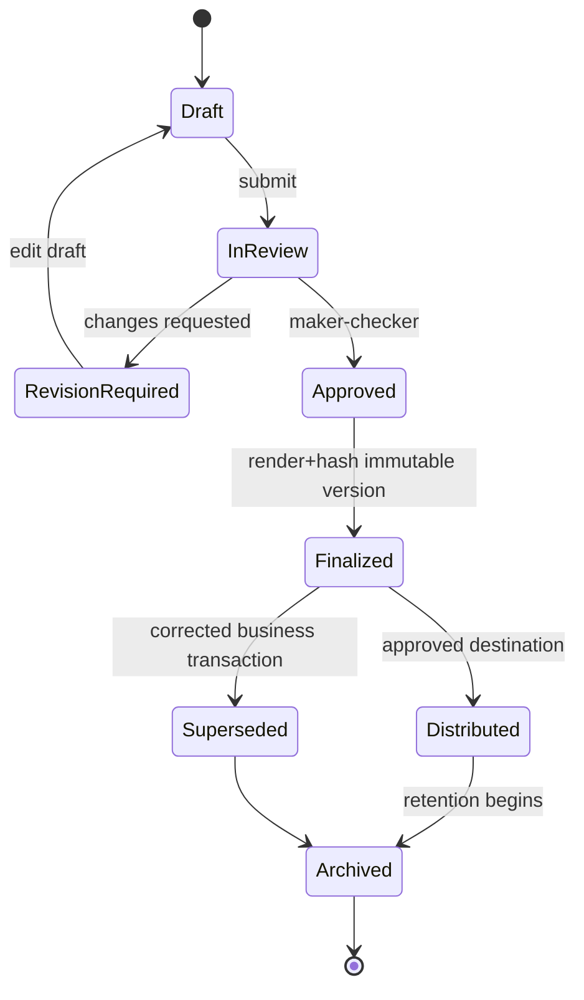

### 4.7 Offline Transaction
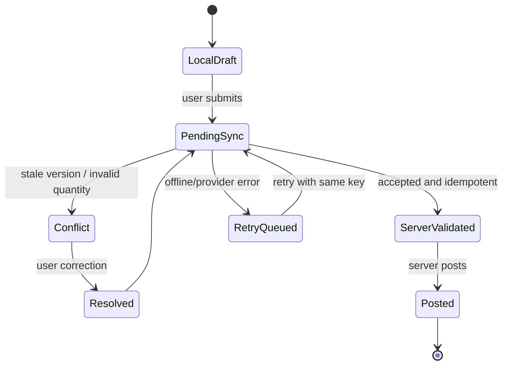

## 5. Sequence diagrams — boundary contracts

### SQ-01 Lead-to-Cash
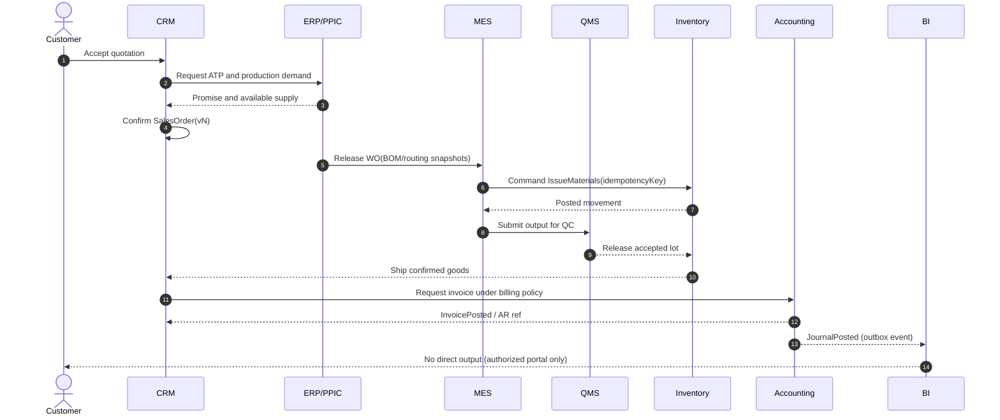

### SQ-02 Procure-to-Pay
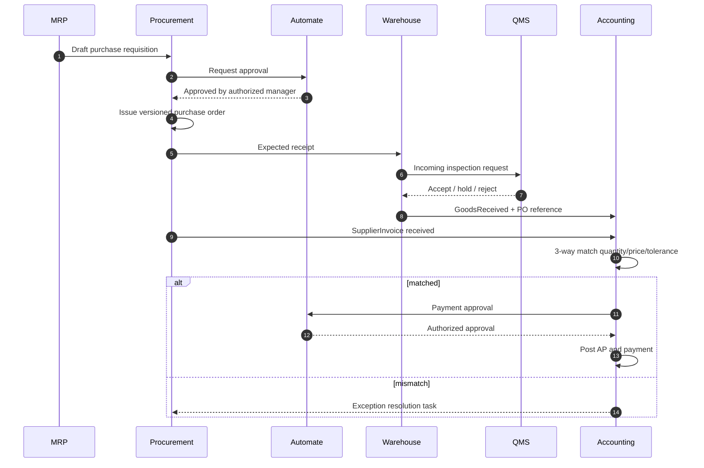

### SQ-03 Plan-to-Produce
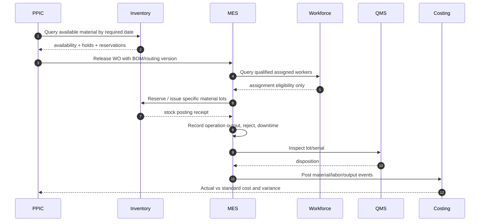

### SQ-04 Hire-to-Payroll-to-Cost
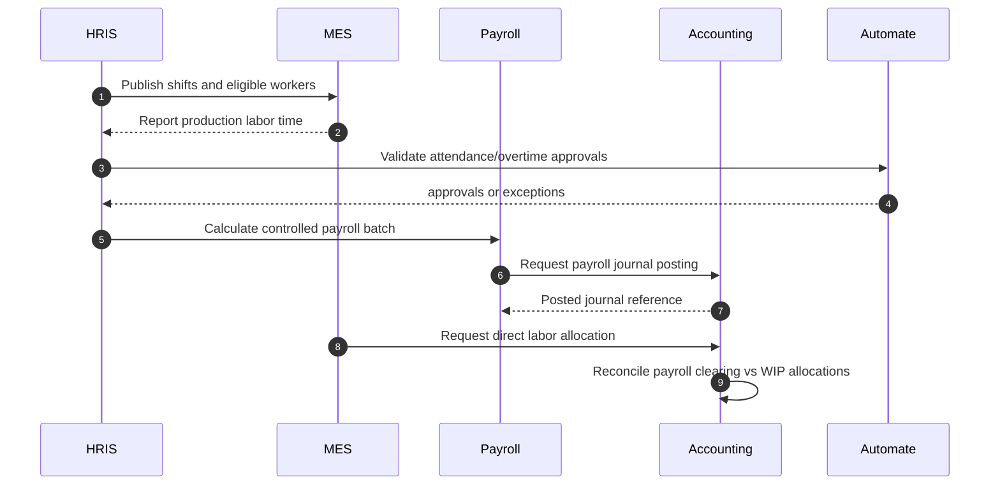

### SQ-05 Official Document & Email
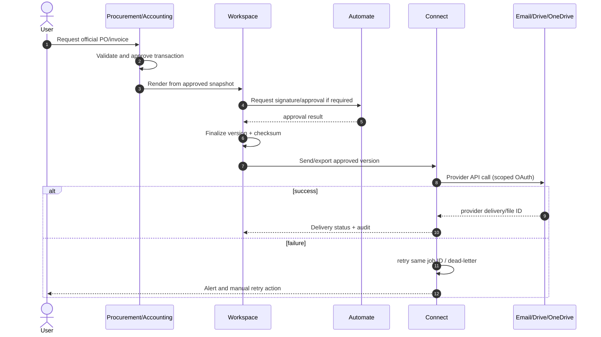

### SQ-06 Email-to-Draft
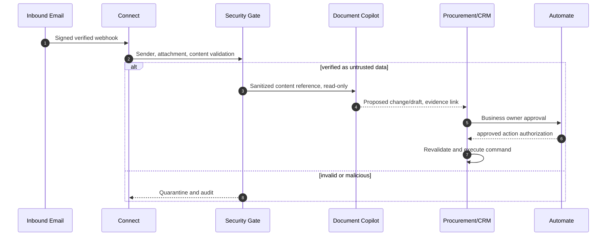

### SQ-07 Company Copilot-to-Action
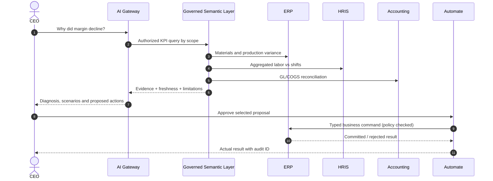

### SQ-08 Offline Shop Floor Sync
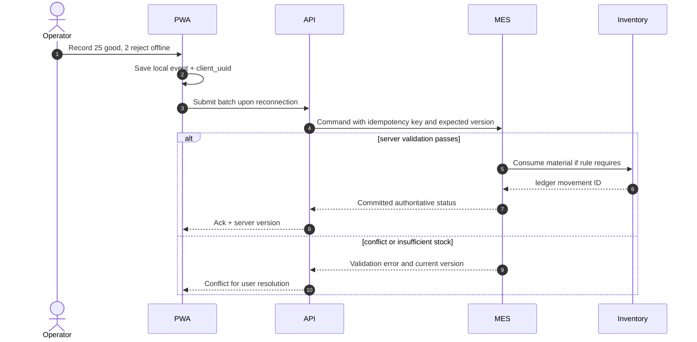

### SQ-09 Breakdown-to-Recovery
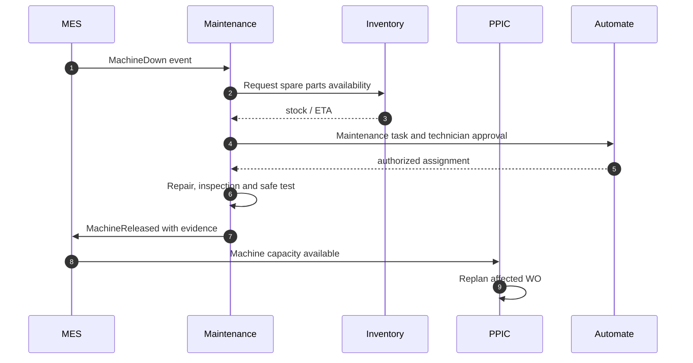

## 6. Failure and compensation patterns
| Failure | Required behavior | Owning service | Recovery check |
|---|---|---|---|
| Event delivered twice | Inbox/event_id de-dup; same business result | Consumer domain | Posted stock, invoice or labor entry appears once |
| Long-running saga fails | Persist state and compensating steps; no partial hidden success | Automate orchestrator | Human-visible failed/compensated status |
| QC hold after output | Prevent allocation/shipment of affected quantity | QMS + Inventory | ATP excludes held stock |
| Sales order changed after WO release | Version amendment and impact analysis; never mutate WO snapshot silently | CRM + PPIC | Reconciliation of previous material reservation |
| Provider upload/email fails | Retry with same logical job; escalation and dead-letter | Connect | Official document remains finalized independent of delivery |
| Offline client repeats POST | Same client_uuid + expected version; server authoritative | MES API | Single output event and movement ledger |
| Payroll vs MES hours disagree | Attendance and production time differentiated; create variance task | HRIS + Finance | Clearing cost bridge reconciles |
| AI tool suggests restricted action | Deny at gateway and owner command boundary | AI + Core | Audit denied attempt; no mutation |

## 7. Authorization sequence
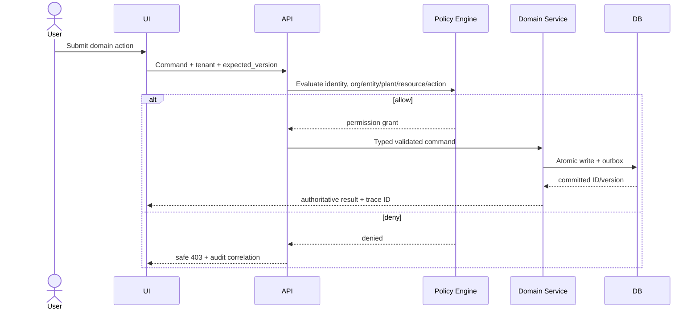

## 8. Implementation checks
- No changes to inventory or GL through a UI-only field edit; require valid domain command.
- Post-once invariant enforced with unique idempotency keys scoped by tenant and action.
- Workflow and document versions never retroactively mutate approved resource snapshots.
- All AI actions receive a policy decision separate from natural-language model suggestions.
- Use-case coverage: UC-01..UC-18; end-to-end sequence coverage SQ-01..SQ-09; source process coverage BP-01..BP-10.

## 9. Open decisions for sign-off
- Precise states for production partial close and controlled cancellation (depends on costing policy).
- Customer billing milestones and Indonesian tax integration provider/approval model.
- Inventory valuation approach per legal entity and WIP reconciliation intervals.
- Ability to execute hybrid batch and discrete steps within one work order vs linked orders.
