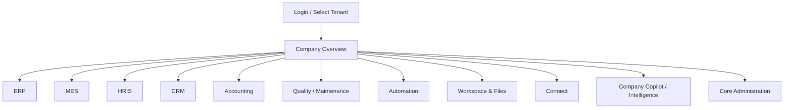

# NewSystem — Screen-by-Screen UX & IA Specification v1.0

**Reference:** NewSystem Master PRD v1.0 | **Date:** 10 Oktober 2026 | **Status:** Founding UX specification and browsable concept prototype.

## 1. UX principles
1. **Role-first navigation**: show only tasks and modules available to active membership, legal entity, plant, and subscription.
2. **Context persistence**: top bar always displays active organization, legal entity, plant, and period where applicable.
3. **Transaction vs document distinction**: official PO/invoice edits operate through owning domain; PDF and files are projections/attachments.
4. **Task-first shop floor**: on operator PWA, prioritize one assigned job and 1–3 core actions; large hit targets, barcode, camera, offline status.
5. **Visible data correctness**: reveal provisional/posted/closed status, timestamps, sync freshness, and source references.
6. **AI as assistive layer**: contextual module Copilot and Company Copilot; suggestions do not self-post restricted operations.
7. **Accessible by default**: keyboard focus, contrast, error summaries, localized numeric/date formats and screenreader semantics.
8. **Scale from manual processes**: no-data empty state provides onboarding path rather than empty graphs.

## 2. Navigation map

## 3. Global shell
- Desktop: collapsible left nav (role-scoped), active entity/plant selector, search/command palette, contextual breadcrumb, task inbox, notifications, module Copilot right drawer.
- Tablet: compact contextual nav, accessible task list, landscape shop-floor cards, scan action always visible.
- Mobile: bottom tabs (Home, Tasks, Work, Files, Copilot); role-appropriate safe quick actions and persistent offline/sync indicator.
- All transactional forms: Save Draft, Validate, Submit/Approve, Cancel, activity log, source links; destructive/costing/financial actions require explicit confirmation and permission check.
- Activity feed entries show actor, timestamp, before/after revision, event source, and correlation ID.

## 4. Screen-by-screen specifications

### SCREEN-01 · CORE-01 — Login & tenant selector
**Route:** `/login`  
**Workspace / roles:** Core · All  
**Primary devices:** Desktop + Mobile  
**Business objective:** allow all to manage login & tenant selector while preserving tenant/entity/plant scope.  
**Layout/content:** SSO/login, tenant list, MFA challenge.  
**Primary CTA:** Continue to chosen organization.  
**States & errors:** Loading skeleton; empty-state onboarding; permission denied; No membership / expired invitation / MFA failure; success receipt with ID and authoritative server version.  
**AI placement:** Contextual Copilot — Help selecting assigned workspace; suggestions shown separately from completed actions.  
**Data contracts:** Identity, memberships; events and queries respect PRD domain ownership.  
**Acceptance:** Navigation deep-link works; browser back/forward preserves scope; keyboard and mobile tasks usable; audit and permission negative tests pass.

### SCREEN-02 · CORE-02 — Company overview
**Route:** `/app/:tenant/overview`  
**Workspace / roles:** Core · CEO,COO  
**Primary devices:** Desktop + Mobile  
**Business objective:** allow ceo,coo to manage company overview while preserving tenant/entity/plant scope.  
**Layout/content:** Cross-suite KPIs, risks, pending approvals, plant comparisons.  
**Primary CTA:** Drill into metric / open action plan.  
**States & errors:** Loading skeleton; empty-state onboarding; permission denied; No data onboarding; stale KPI watermark; success receipt with ID and authoritative server version.  
**AI placement:** Contextual Copilot — Explain margin drop with citations; suggestions shown separately from completed actions.  
**Data contracts:** BI semantic metrics, GL, MES, CRM; events and queries respect PRD domain ownership.  
**Acceptance:** Navigation deep-link works; browser back/forward preserves scope; keyboard and mobile tasks usable; audit and permission negative tests pass.

### SCREEN-03 · CORE-03 — Plant / legal entity switcher
**Route:** `/app/:tenant/scope`  
**Workspace / roles:** Core · All  
**Primary devices:** Desktop + Mobile  
**Business objective:** allow all to manage plant / legal entity switcher while preserving tenant/entity/plant scope.  
**Layout/content:** Entity hierarchy, authorized plants, active modules.  
**Primary CTA:** Switch active plant.  
**States & errors:** Loading skeleton; empty-state onboarding; permission denied; No access / plant suspended; success receipt with ID and authoritative server version.  
**AI placement:** Contextual Copilot — Explain available workspaces; suggestions shown separately from completed actions.  
**Data contracts:** Company, plant, RBAC; events and queries respect PRD domain ownership.  
**Acceptance:** Navigation deep-link works; browser back/forward preserves scope; keyboard and mobile tasks usable; audit and permission negative tests pass.

### SCREEN-04 · CORE-04 — My tasks & approvals
**Route:** `/app/:tenant/tasks`  
**Workspace / roles:** Core · All  
**Primary devices:** Desktop + Mobile  
**Business objective:** allow all to manage my tasks & approvals while preserving tenant/entity/plant scope.  
**Layout/content:** Task inbox, approval queue, due dates, delegated approvals.  
**Primary CTA:** Approve / reject / delegate within rules.  
**States & errors:** Loading skeleton; empty-state onboarding; permission denied; Expired/withdrawn approval; SoD denied; success receipt with ID and authoritative server version.  
**AI placement:** Contextual Copilot — Summarize approval context; suggestions shown separately from completed actions.  
**Data contracts:** Workflow, domain refs; events and queries respect PRD domain ownership.  
**Acceptance:** Navigation deep-link works; browser back/forward preserves scope; keyboard and mobile tasks usable; audit and permission negative tests pass.

### SCREEN-05 · CORE-05 — Guided onboarding
**Route:** `/app/:tenant/onboarding`  
**Workspace / roles:** Core · Owner,Tenant Admin  
**Primary devices:** Desktop  
**Business objective:** allow owner,tenant admin to manage guided onboarding while preserving tenant/entity/plant scope.  
**Layout/content:** Legal entity, plant, department, industry pack wizard.  
**Primary CTA:** Save step / dry-run migration.  
**States & errors:** Loading skeleton; empty-state onboarding; permission denied; Missing fiscal policy or inconsistent UOM; success receipt with ID and authoritative server version.  
**AI placement:** Contextual Copilot — Suggest field mappings; suggestions shown separately from completed actions.  
**Data contracts:** Core, ERP, HR, Accounting; events and queries respect PRD domain ownership.  
**Acceptance:** Navigation deep-link works; browser back/forward preserves scope; keyboard and mobile tasks usable; audit and permission negative tests pass.

### SCREEN-06 · CORE-06 — User / role administration
**Route:** `/app/:tenant/admin/access`  
**Workspace / roles:** Core · Tenant Admin  
**Primary devices:** Desktop  
**Business objective:** allow tenant admin to manage user / role administration while preserving tenant/entity/plant scope.  
**Layout/content:** Users, roles, entity/plant scopes, SoD policies.  
**Primary CTA:** Invite user / update role.  
**States & errors:** Loading skeleton; empty-state onboarding; permission denied; Access conflicts / no security administrator; success receipt with ID and authoritative server version.  
**AI placement:** Contextual Copilot — Draft least privilege roles; suggestions shown separately from completed actions.  
**Data contracts:** IAM, audit; events and queries respect PRD domain ownership.  
**Acceptance:** Navigation deep-link works; browser back/forward preserves scope; keyboard and mobile tasks usable; audit and permission negative tests pass.

### SCREEN-07 · CORE-07 — Module & industry activation
**Route:** `/app/:tenant/admin/modules`  
**Workspace / roles:** Core · Tenant Admin  
**Primary devices:** Desktop  
**Business objective:** allow tenant admin to manage module & industry activation while preserving tenant/entity/plant scope.  
**Layout/content:** Entitlements, dependency graph, production mode by plant.  
**Primary CTA:** Preview impacts / activate.  
**States & errors:** Loading skeleton; empty-state onboarding; permission denied; Incompatible module; active business objects; success receipt with ID and authoritative server version.  
**AI placement:** Contextual Copilot — Explain dependencies; suggestions shown separately from completed actions.  
**Data contracts:** Module registry, subscriptions; events and queries respect PRD domain ownership.  
**Acceptance:** Navigation deep-link works; browser back/forward preserves scope; keyboard and mobile tasks usable; audit and permission negative tests pass.

### SCREEN-08 · CORE-08 — Company & plant configuration
**Route:** `/app/:tenant/admin/organization`  
**Workspace / roles:** Core · Tenant Admin  
**Primary devices:** Desktop  
**Business objective:** allow tenant admin to manage company & plant configuration while preserving tenant/entity/plant scope.  
**Layout/content:** Legal entities, warehouses, lines, work centers, fiscal timezone.  
**Primary CTA:** Create plant / manage scopes.  
**States & errors:** Loading skeleton; empty-state onboarding; permission denied; Duplicate code / invalid legal entity; success receipt with ID and authoritative server version.  
**AI placement:** Contextual Copilot — Recommend setup checklist; suggestions shown separately from completed actions.  
**Data contracts:** Core master; events and queries respect PRD domain ownership.  
**Acceptance:** Navigation deep-link works; browser back/forward preserves scope; keyboard and mobile tasks usable; audit and permission negative tests pass.

### SCREEN-09 · ERP-01 — ERP workspace dashboard
**Route:** `/app/:tenant/:plant/erp`  
**Workspace / roles:** ERP · PPIC,Procurement  
**Primary devices:** Desktop  
**Business objective:** allow ppic,procurement to manage erp workspace dashboard while preserving tenant/entity/plant scope.  
**Layout/content:** Open planning shortages, stock, POs, alerts.  
**Primary CTA:** Investigate shortage.  
**States & errors:** Loading skeleton; empty-state onboarding; permission denied; Stale MRP; partial data; success receipt with ID and authoritative server version.  
**AI placement:** Contextual Copilot — Supply planner copilot; suggestions shown separately from completed actions.  
**Data contracts:** ERP/BI; events and queries respect PRD domain ownership.  
**Acceptance:** Navigation deep-link works; browser back/forward preserves scope; keyboard and mobile tasks usable; audit and permission negative tests pass.

### SCREEN-10 · ERP-02 — Item & UOM master
**Route:** `/app/:tenant/erp/items`  
**Workspace / roles:** ERP · Inventory Admin,PPIC  
**Primary devices:** Desktop  
**Business objective:** allow inventory admin,ppic to manage item & uom master while preserving tenant/entity/plant scope.  
**Layout/content:** SKU grid, variants, UOM conversions, lot policy.  
**Primary CTA:** Create/revise item.  
**States & errors:** Loading skeleton; empty-state onboarding; permission denied; Invalid conversion / duplicate SKU; success receipt with ID and authoritative server version.  
**AI placement:** Contextual Copilot — Import assistant; suggestions shown separately from completed actions.  
**Data contracts:** Item master; events and queries respect PRD domain ownership.  
**Acceptance:** Navigation deep-link works; browser back/forward preserves scope; keyboard and mobile tasks usable; audit and permission negative tests pass.

### SCREEN-11 · ERP-03 — BOM / recipe editor
**Route:** `/app/:tenant/erp/bom/:id`  
**Workspace / roles:** ERP · Engineering,PPIC  
**Primary devices:** Desktop  
**Business objective:** allow engineering,ppic to manage bom / recipe editor while preserving tenant/entity/plant scope.  
**Layout/content:** Version tree, component quantities, substitutes, scrap allowance.  
**Primary CTA:** Submit BOM revision.  
**States & errors:** Loading skeleton; empty-state onboarding; permission denied; Released WO uses snapshot; circular BOM; success receipt with ID and authoritative server version.  
**AI placement:** Contextual Copilot — Suggest material alternatives; suggestions shown separately from completed actions.  
**Data contracts:** BOM version, items; events and queries respect PRD domain ownership.  
**Acceptance:** Navigation deep-link works; browser back/forward preserves scope; keyboard and mobile tasks usable; audit and permission negative tests pass.

### SCREEN-12 · ERP-04 — Routing & work centers
**Route:** `/app/:tenant/erp/routing/:id`  
**Workspace / roles:** ERP · PPIC,Engineering  
**Primary devices:** Desktop  
**Business objective:** allow ppic,engineering to manage routing & work centers while preserving tenant/entity/plant scope.  
**Layout/content:** Operation steps, dependencies, work center capacity, standards.  
**Primary CTA:** Publish routing version.  
**States & errors:** Loading skeleton; empty-state onboarding; permission denied; Circular dependency; missing work center; success receipt with ID and authoritative server version.  
**AI placement:** Contextual Copilot — Simulate cycle-time effects; suggestions shown separately from completed actions.  
**Data contracts:** Routing, work centers; events and queries respect PRD domain ownership.  
**Acceptance:** Navigation deep-link works; browser back/forward preserves scope; keyboard and mobile tasks usable; audit and permission negative tests pass.

### SCREEN-13 · ERP-05 — Demand / MRP planner
**Route:** `/app/:tenant/erp/planning`  
**Workspace / roles:** ERP · PPIC  
**Primary devices:** Desktop  
**Business objective:** allow ppic to manage demand / mrp planner while preserving tenant/entity/plant scope.  
**Layout/content:** Demand timeline, net requirements, availability, capacity, scenarios.  
**Primary CTA:** Create plan / release WO.  
**States & errors:** Loading skeleton; empty-state onboarding; permission denied; Material shortage; overcapacity; success receipt with ID and authoritative server version.  
**AI placement:** Contextual Copilot — Simulate alternate schedules; suggestions shown separately from completed actions.  
**Data contracts:** SO, BOM, stock, shifts; events and queries respect PRD domain ownership.  
**Acceptance:** Navigation deep-link works; browser back/forward preserves scope; keyboard and mobile tasks usable; audit and permission negative tests pass.

### SCREEN-14 · ERP-06 — Purchase requisition & PO
**Route:** `/app/:tenant/erp/purchasing`  
**Workspace / roles:** ERP · Purchasing  
**Primary devices:** Desktop  
**Business objective:** allow purchasing to manage purchase requisition & po while preserving tenant/entity/plant scope.  
**Layout/content:** PR/PO queue, suppliers, RFQ comparisons, approval.  
**Primary CTA:** Draft PO / submit approval.  
**States & errors:** Loading skeleton; empty-state onboarding; permission denied; Spend limits / amended order; success receipt with ID and authoritative server version.  
**AI placement:** Contextual Copilot — Supplier comparison copilot; suggestions shown separately from completed actions.  
**Data contracts:** Purchase order, suppliers, rules; events and queries respect PRD domain ownership.  
**Acceptance:** Navigation deep-link works; browser back/forward preserves scope; keyboard and mobile tasks usable; audit and permission negative tests pass.

### SCREEN-15 · ERP-07 — Receiving & putaway
**Route:** `/app/:tenant/:plant/erp/receiving`  
**Workspace / roles:** ERP · Warehouse  
**Primary devices:** Tablet + Desktop  
**Business objective:** allow warehouse to manage receiving & putaway while preserving tenant/entity/plant scope.  
**Layout/content:** Expected PO lines, scan lot, discrepancy, staging, QC status.  
**Primary CTA:** Post receipt.  
**States & errors:** Loading skeleton; empty-state onboarding; permission denied; Partial receipt, rejected lot, offline issue; success receipt with ID and authoritative server version.  
**AI placement:** Contextual Copilot — Extract delivery note; suggestions shown separately from completed actions.  
**Data contracts:** GRN, lot, QMS; events and queries respect PRD domain ownership.  
**Acceptance:** Navigation deep-link works; browser back/forward preserves scope; keyboard and mobile tasks usable; audit and permission negative tests pass.

### SCREEN-16 · ERP-08 — Inventory balances & movements
**Route:** `/app/:tenant/:plant/erp/inventory`  
**Workspace / roles:** ERP · Warehouse,PPIC  
**Primary devices:** Desktop + Tablet  
**Business objective:** allow warehouse,ppic to manage inventory balances & movements while preserving tenant/entity/plant scope.  
**Layout/content:** On-hand/reserved/blocked/available, warehouse filters, ledger.  
**Primary CTA:** Reserve / transfer / count.  
**States & errors:** Loading skeleton; empty-state onboarding; permission denied; Concurrent reservation; hold lot; success receipt with ID and authoritative server version.  
**AI placement:** Contextual Copilot — Explain stock variance; suggestions shown separately from completed actions.  
**Data contracts:** Inventory ledger; events and queries respect PRD domain ownership.  
**Acceptance:** Navigation deep-link works; browser back/forward preserves scope; keyboard and mobile tasks usable; audit and permission negative tests pass.

### SCREEN-17 · ERP-09 — Shipping & delivery
**Route:** `/app/:tenant/:plant/erp/shipping`  
**Workspace / roles:** ERP · Warehouse,Sales  
**Primary devices:** Desktop + Tablet  
**Business objective:** allow warehouse,sales to manage shipping & delivery while preserving tenant/entity/plant scope.  
**Layout/content:** Pick list, shipments, proof of delivery, partial quantities.  
**Primary CTA:** Confirm shipment.  
**States & errors:** Loading skeleton; empty-state onboarding; permission denied; QC hold / serial mismatch; success receipt with ID and authoritative server version.  
**AI placement:** Contextual Copilot — Suggest fulfillment grouping; suggestions shown separately from completed actions.  
**Data contracts:** Inventory, CRM, accounting; events and queries respect PRD domain ownership.  
**Acceptance:** Navigation deep-link works; browser back/forward preserves scope; keyboard and mobile tasks usable; audit and permission negative tests pass.

### SCREEN-18 · MES-01 — Shop-floor board
**Route:** `/app/:tenant/:plant/mes/board`  
**Workspace / roles:** MES · Supervisor  
**Primary devices:** Tablet + Desktop  
**Business objective:** allow supervisor to manage shop-floor board while preserving tenant/entity/plant scope.  
**Layout/content:** Work center cards, order progress, downtime, blocked jobs.  
**Primary CTA:** Assign or open job.  
**States & errors:** Loading skeleton; empty-state onboarding; permission denied; Machine down / no staff / stale data; success receipt with ID and authoritative server version.  
**AI placement:** Contextual Copilot — Operational risk summaries; suggestions shown separately from completed actions.  
**Data contracts:** MES, HRIS, QMS; events and queries respect PRD domain ownership.  
**Acceptance:** Navigation deep-link works; browser back/forward preserves scope; keyboard and mobile tasks usable; audit and permission negative tests pass.

### SCREEN-19 · MES-02 — Production order detail
**Route:** `/app/:tenant/:plant/mes/orders/:id`  
**Workspace / roles:** MES · PPIC,Supervisor  
**Primary devices:** Desktop + Tablet  
**Business objective:** allow ppic,supervisor to manage production order detail while preserving tenant/entity/plant scope.  
**Layout/content:** BOM/routing snapshots, readiness, activity feed, linked costs.  
**Primary CTA:** Release / pause / close.  
**States & errors:** Loading skeleton; empty-state onboarding; permission denied; Shortage / QC pending / cost discrepancy; success receipt with ID and authoritative server version.  
**AI placement:** Contextual Copilot — Explain delays; suggestions shown separately from completed actions.  
**Data contracts:** ERP, MES, costing; events and queries respect PRD domain ownership.  
**Acceptance:** Navigation deep-link works; browser back/forward preserves scope; keyboard and mobile tasks usable; audit and permission negative tests pass.

### SCREEN-20 · MES-03 — Operator job card
**Route:** `/app/:tenant/:plant/mes/jobs/:id`  
**Workspace / roles:** MES · Operator  
**Primary devices:** Mobile + Tablet  
**Business objective:** allow operator to manage operator job card while preserving tenant/entity/plant scope.  
**Layout/content:** Big start/pause/complete, SOP, material scan, good/reject qty.  
**Primary CTA:** Record output.  
**States & errors:** Loading skeleton; empty-state onboarding; permission denied; Offline draft, wrong work center, no assigned job; success receipt with ID and authoritative server version.  
**AI placement:** Contextual Copilot — Explain SOP and reasons; suggestions shown separately from completed actions.  
**Data contracts:** MES, DMS, HR eligibility; events and queries respect PRD domain ownership.  
**Acceptance:** Navigation deep-link works; browser back/forward preserves scope; keyboard and mobile tasks usable; audit and permission negative tests pass.

### SCREEN-21 · MES-04 — Batch & lot genealogy
**Route:** `/app/:tenant/:plant/mes/trace/:lot`  
**Workspace / roles:** MES · QC,Supervisor  
**Primary devices:** Desktop + Tablet  
**Business objective:** allow qc,supervisor to manage batch & lot genealogy while preserving tenant/entity/plant scope.  
**Layout/content:** Material input lots, transformations, output lots, expiry/status.  
**Primary CTA:** Trace upstream/downstream.  
**States & errors:** Loading skeleton; empty-state onboarding; permission denied; Missing lineage; recall impacted customers; success receipt with ID and authoritative server version.  
**AI placement:** Contextual Copilot — Summarize batch deviation; suggestions shown separately from completed actions.  
**Data contracts:** Lots, material movements, QMS; events and queries respect PRD domain ownership.  
**Acceptance:** Navigation deep-link works; browser back/forward preserves scope; keyboard and mobile tasks usable; audit and permission negative tests pass.

### SCREEN-22 · MES-05 — Downtime capture
**Route:** `/app/:tenant/:plant/mes/downtime`  
**Workspace / roles:** MES · Operator,Supervisor  
**Primary devices:** Mobile + Tablet  
**Business objective:** allow operator,supervisor to manage downtime capture while preserving tenant/entity/plant scope.  
**Layout/content:** Equipment state, downtime reason, timer, photo evidence.  
**Primary CTA:** Record stop/restart report.  
**States & errors:** Loading skeleton; empty-state onboarding; permission denied; Safety release missing; success receipt with ID and authoritative server version.  
**AI placement:** Contextual Copilot — Summarize downtime trend; suggestions shown separately from completed actions.  
**Data contracts:** MES, Maintenance; events and queries respect PRD domain ownership.  
**Acceptance:** Navigation deep-link works; browser back/forward preserves scope; keyboard and mobile tasks usable; audit and permission negative tests pass.

### SCREEN-23 · QMS-01 — Inspection queue & forms
**Route:** `/app/:tenant/:plant/quality/inspections`  
**Workspace / roles:** Quality · QC Inspector  
**Primary devices:** Tablet + Mobile  
**Business objective:** allow qc inspector to manage inspection queue & forms while preserving tenant/entity/plant scope.  
**Layout/content:** Pending QC, sampling plan, tolerances, evidence photo.  
**Primary CTA:** Pass / Hold / Reject.  
**States & errors:** Loading skeleton; empty-state onboarding; permission denied; Cannot self-approve release; incomplete tests; success receipt with ID and authoritative server version.  
**AI placement:** Contextual Copilot — Draft inspection narrative; suggestions shown separately from completed actions.  
**Data contracts:** QMS, lots, DMS; events and queries respect PRD domain ownership.  
**Acceptance:** Navigation deep-link works; browser back/forward preserves scope; keyboard and mobile tasks usable; audit and permission negative tests pass.

### SCREEN-24 · QMS-02 — NCR / CAPA workspace
**Route:** `/app/:tenant/:plant/quality/ncr/:id`  
**Workspace / roles:** Quality · QC Manager  
**Primary devices:** Desktop + Tablet  
**Business objective:** allow qc manager to manage ncr / capa workspace while preserving tenant/entity/plant scope.  
**Layout/content:** Defect case, related lot/orders, root cause, CAPA tasks.  
**Primary CTA:** Approve disposition / close.  
**States & errors:** Loading skeleton; empty-state onboarding; permission denied; Affected shipped batch / effectiveness pending; success receipt with ID and authoritative server version.  
**AI placement:** Contextual Copilot — Root cause hypotheses; suggestions shown separately from completed actions.  
**Data contracts:** QMS, MES, CRM; events and queries respect PRD domain ownership.  
**Acceptance:** Navigation deep-link works; browser back/forward preserves scope; keyboard and mobile tasks usable; audit and permission negative tests pass.

### SCREEN-25 · MT-01 — Machine & asset registry
**Route:** `/app/:tenant/:plant/maintenance/assets`  
**Workspace / roles:** Maintenance · Maintenance  
**Primary devices:** Desktop  
**Business objective:** allow maintenance to manage machine & asset registry while preserving tenant/entity/plant scope.  
**Layout/content:** Assets, service interval, manuals, calibration, history.  
**Primary CTA:** Schedule maintenance.  
**States & errors:** Loading skeleton; empty-state onboarding; permission denied; Expired calibration / retired machine; success receipt with ID and authoritative server version.  
**AI placement:** Contextual Copilot — Maintenance risk summaries; suggestions shown separately from completed actions.  
**Data contracts:** Equipment, DMS; events and queries respect PRD domain ownership.  
**Acceptance:** Navigation deep-link works; browser back/forward preserves scope; keyboard and mobile tasks usable; audit and permission negative tests pass.

### SCREEN-26 · MT-02 — Repair work order
**Route:** `/app/:tenant/:plant/maintenance/orders/:id`  
**Workspace / roles:** Maintenance · Technician,Supervisor  
**Primary devices:** Tablet + Mobile  
**Business objective:** allow technician,supervisor to manage repair work order while preserving tenant/entity/plant scope.  
**Layout/content:** Failure notes, spare parts, technician, safety signoff.  
**Primary CTA:** Request safe release.  
**States & errors:** Loading skeleton; empty-state onboarding; permission denied; Parts unavailable / test failure; success receipt with ID and authoritative server version.  
**AI placement:** Contextual Copilot — Suggest repair checklist; suggestions shown separately from completed actions.  
**Data contracts:** Maintenance, ERP, HRIS; events and queries respect PRD domain ownership.  
**Acceptance:** Navigation deep-link works; browser back/forward preserves scope; keyboard and mobile tasks usable; audit and permission negative tests pass.

### SCREEN-27 · HR-01 — Employee directory / profile
**Route:** `/app/:tenant/hris/employees`  
**Workspace / roles:** HRIS · HR  
**Primary devices:** Desktop  
**Business objective:** allow hr to manage employee directory / profile while preserving tenant/entity/plant scope.  
**Layout/content:** Employee master, contracts, team, qualifications, confidential tabs.  
**Primary CTA:** Onboard / amend contract.  
**States & errors:** Loading skeleton; empty-state onboarding; permission denied; PII permission / duplicate employee; success receipt with ID and authoritative server version.  
**AI placement:** Contextual Copilot — Document drafting; suggestions shown separately from completed actions.  
**Data contracts:** HRIS, DMS; events and queries respect PRD domain ownership.  
**Acceptance:** Navigation deep-link works; browser back/forward preserves scope; keyboard and mobile tasks usable; audit and permission negative tests pass.

### SCREEN-28 · HR-02 — Attendance & shift planner
**Route:** `/app/:tenant/:plant/hris/shifts`  
**Workspace / roles:** HRIS · HR,Supervisor  
**Primary devices:** Desktop + Tablet  
**Business objective:** allow hr,supervisor to manage attendance & shift planner while preserving tenant/entity/plant scope.  
**Layout/content:** Shift calendar, skills, leave, attendance exceptions.  
**Primary CTA:** Publish roster.  
**States & errors:** Loading skeleton; empty-state onboarding; permission denied; Understaffed, overlapping shifts; success receipt with ID and authoritative server version.  
**AI placement:** Contextual Copilot — Generate skill-aware roster; suggestions shown separately from completed actions.  
**Data contracts:** HRIS, MES; events and queries respect PRD domain ownership.  
**Acceptance:** Navigation deep-link works; browser back/forward preserves scope; keyboard and mobile tasks usable; audit and permission negative tests pass.

### SCREEN-29 · HR-03 — Leave & overtime approvals
**Route:** `/app/:tenant/hris/requests`  
**Workspace / roles:** HRIS · HR,Employee  
**Primary devices:** Mobile + Desktop  
**Business objective:** allow hr,employee to manage leave & overtime approvals while preserving tenant/entity/plant scope.  
**Layout/content:** Balance, requests, approvals, policy, conflicts.  
**Primary CTA:** Request / approve.  
**States & errors:** Loading skeleton; empty-state onboarding; permission denied; Insufficient leave, SoD; success receipt with ID and authoritative server version.  
**AI placement:** Contextual Copilot — Policy explanation; suggestions shown separately from completed actions.  
**Data contracts:** HRIS, workflow; events and queries respect PRD domain ownership.  
**Acceptance:** Navigation deep-link works; browser back/forward preserves scope; keyboard and mobile tasks usable; audit and permission negative tests pass.

### SCREEN-30 · HR-04 — Payroll processing
**Route:** `/app/:tenant/:entity/hris/payroll`  
**Workspace / roles:** HRIS · Payroll Manager  
**Primary devices:** Desktop  
**Business objective:** allow payroll manager to manage payroll processing while preserving tenant/entity/plant scope.  
**Layout/content:** Payroll batches, statutory deductions, variance, confidential preview.  
**Primary CTA:** Calculate / approve / finalize.  
**States & errors:** Loading skeleton; empty-state onboarding; permission denied; Open adjustments / locked batch; success receipt with ID and authoritative server version.  
**AI placement:** Contextual Copilot — Explain variance (restricted); suggestions shown separately from completed actions.  
**Data contracts:** HRIS, accounting; events and queries respect PRD domain ownership.  
**Acceptance:** Navigation deep-link works; browser back/forward preserves scope; keyboard and mobile tasks usable; audit and permission negative tests pass.

### SCREEN-31 · HR-05 — Performance & training
**Route:** `/app/:tenant/hris/development`  
**Workspace / roles:** HRIS · HR,Manager  
**Primary devices:** Desktop  
**Business objective:** allow hr,manager to manage performance & training while preserving tenant/entity/plant scope.  
**Layout/content:** Goals, appraisal, certification expiry, training records.  
**Primary CTA:** Assign learning / review.  
**States & errors:** Loading skeleton; empty-state onboarding; permission denied; Employee private data boundary; success receipt with ID and authoritative server version.  
**AI placement:** Contextual Copilot — Skills gap insights; suggestions shown separately from completed actions.  
**Data contracts:** HRIS, operations; events and queries respect PRD domain ownership.  
**Acceptance:** Navigation deep-link works; browser back/forward preserves scope; keyboard and mobile tasks usable; audit and permission negative tests pass.

### SCREEN-32 · CRM-01 — Lead & opportunity pipeline
**Route:** `/app/:tenant/crm/pipeline`  
**Workspace / roles:** CRM · Sales  
**Primary devices:** Desktop + Mobile  
**Business objective:** allow sales to manage lead & opportunity pipeline while preserving tenant/entity/plant scope.  
**Layout/content:** Kanban pipeline, owner, value, stage, next actions.  
**Primary CTA:** Create / advance opportunity.  
**States & errors:** Loading skeleton; empty-state onboarding; permission denied; No contact / restricted customer; success receipt with ID and authoritative server version.  
**AI placement:** Contextual Copilot — Follow-up draft; suggestions shown separately from completed actions.  
**Data contracts:** CRM, email; events and queries respect PRD domain ownership.  
**Acceptance:** Navigation deep-link works; browser back/forward preserves scope; keyboard and mobile tasks usable; audit and permission negative tests pass.

### SCREEN-33 · CRM-02 — Customer 360 workspace
**Route:** `/app/:tenant/crm/customers/:id`  
**Workspace / roles:** CRM · Sales,Support  
**Primary devices:** Desktop  
**Business objective:** allow sales,support to manage customer 360 workspace while preserving tenant/entity/plant scope.  
**Layout/content:** Account, contacts, orders, invoices statuses, emails, files.  
**Primary CTA:** Create quotation / ticket.  
**States & errors:** Loading skeleton; empty-state onboarding; permission denied; Cross-entity visibility; duplicate account; success receipt with ID and authoritative server version.  
**AI placement:** Contextual Copilot — Customer summaries; suggestions shown separately from completed actions.  
**Data contracts:** CRM, accounting, connect; events and queries respect PRD domain ownership.  
**Acceptance:** Navigation deep-link works; browser back/forward preserves scope; keyboard and mobile tasks usable; audit and permission negative tests pass.

### SCREEN-34 · CRM-03 — Quotation editor with ATP
**Route:** `/app/:tenant/crm/quotes/:id`  
**Workspace / roles:** CRM · Sales  
**Primary devices:** Desktop  
**Business objective:** allow sales to manage quotation editor with atp while preserving tenant/entity/plant scope.  
**Layout/content:** Price lines, discount, capacity promise, margin, approval.  
**Primary CTA:** Submit quotation.  
**States & errors:** Loading skeleton; empty-state onboarding; permission denied; Below-margin pricing / stale ATP; success receipt with ID and authoritative server version.  
**AI placement:** Contextual Copilot — Draft proposal and delivery options; suggestions shown separately from completed actions.  
**Data contracts:** CRM, ERP, costing; events and queries respect PRD domain ownership.  
**Acceptance:** Navigation deep-link works; browser back/forward preserves scope; keyboard and mobile tasks usable; audit and permission negative tests pass.

### SCREEN-35 · CRM-04 — Sales order lifecycle
**Route:** `/app/:tenant/crm/orders/:id`  
**Workspace / roles:** CRM · Sales,PPIC  
**Primary devices:** Desktop + Mobile  
**Business objective:** allow sales,ppic to manage sales order lifecycle while preserving tenant/entity/plant scope.  
**Layout/content:** Confirmed spec/version, linked WO, deliveries, invoices.  
**Primary CTA:** Request revision / follow progress.  
**States & errors:** Loading skeleton; empty-state onboarding; permission denied; WO started / contractual limit; success receipt with ID and authoritative server version.  
**AI placement:** Contextual Copilot — Explain order ETA; suggestions shown separately from completed actions.  
**Data contracts:** CRM, ERP, accounting; events and queries respect PRD domain ownership.  
**Acceptance:** Navigation deep-link works; browser back/forward preserves scope; keyboard and mobile tasks usable; audit and permission negative tests pass.

### SCREEN-36 · CRM-05 — Support tickets & RMA
**Route:** `/app/:tenant/crm/service`  
**Workspace / roles:** CRM · Support  
**Primary devices:** Desktop + Mobile  
**Business objective:** allow support to manage support tickets & rma while preserving tenant/entity/plant scope.  
**Layout/content:** Cases, return authorization, defect link, SLA.  
**Primary CTA:** Assign / resolve.  
**States & errors:** Loading skeleton; empty-state onboarding; permission denied; Safety recall / closed financial period; success receipt with ID and authoritative server version.  
**AI placement:** Contextual Copilot — Draft customer response; suggestions shown separately from completed actions.  
**Data contracts:** CRM, QMS, warehouse; events and queries respect PRD domain ownership.  
**Acceptance:** Navigation deep-link works; browser back/forward preserves scope; keyboard and mobile tasks usable; audit and permission negative tests pass.

### SCREEN-37 · ACC-01 — Finance executive dashboard
**Route:** `/app/:tenant/:entity/accounting/overview`  
**Workspace / roles:** Accounting · Finance,CEO  
**Primary devices:** Desktop  
**Business objective:** allow finance,ceo to manage finance executive dashboard while preserving tenant/entity/plant scope.  
**Layout/content:** P&L, balance, cash, AR/AP, period status, cost variance.  
**Primary CTA:** Open journal drilldown.  
**States & errors:** Loading skeleton; empty-state onboarding; permission denied; Provisional costs; multi-entity consolidation; success receipt with ID and authoritative server version.  
**AI placement:** Contextual Copilot — Finance Copilot analysis; suggestions shown separately from completed actions.  
**Data contracts:** GL, subledgers; events and queries respect PRD domain ownership.  
**Acceptance:** Navigation deep-link works; browser back/forward preserves scope; keyboard and mobile tasks usable; audit and permission negative tests pass.

### SCREEN-38 · ACC-02 — General ledger & journal
**Route:** `/app/:tenant/:entity/accounting/journals`  
**Workspace / roles:** Accounting · Accountant  
**Primary devices:** Desktop  
**Business objective:** allow accountant to manage general ledger & journal while preserving tenant/entity/plant scope.  
**Layout/content:** Journal grid, debit-credit, source refs, period state.  
**Primary CTA:** Post / reverse controlled journal.  
**States & errors:** Loading skeleton; empty-state onboarding; permission denied; Unbalanced / locked period; success receipt with ID and authoritative server version.  
**AI placement:** Contextual Copilot — Explain suspicious journal; suggestions shown separately from completed actions.  
**Data contracts:** GL, workflow; events and queries respect PRD domain ownership.  
**Acceptance:** Navigation deep-link works; browser back/forward preserves scope; keyboard and mobile tasks usable; audit and permission negative tests pass.

### SCREEN-39 · ACC-03 — Accounts payable & matching
**Route:** `/app/:tenant/:entity/accounting/ap`  
**Workspace / roles:** Accounting · AP Accountant  
**Primary devices:** Desktop  
**Business objective:** allow ap accountant to manage accounts payable & matching while preserving tenant/entity/plant scope.  
**Layout/content:** Supplier bills, PO/GRN match, due schedule.  
**Primary CTA:** Approve bill / pay request.  
**States & errors:** Loading skeleton; empty-state onboarding; permission denied; Quantity/price mismatch; duplicate invoice; success receipt with ID and authoritative server version.  
**AI placement:** Contextual Copilot — Extract invoice fields; suggestions shown separately from completed actions.  
**Data contracts:** Procurement, receiving; events and queries respect PRD domain ownership.  
**Acceptance:** Navigation deep-link works; browser back/forward preserves scope; keyboard and mobile tasks usable; audit and permission negative tests pass.

### SCREEN-40 · ACC-04 — AR invoicing
**Route:** `/app/:tenant/:entity/accounting/ar`  
**Workspace / roles:** Accounting · AR Accountant  
**Primary devices:** Desktop  
**Business objective:** allow ar accountant to manage ar invoicing while preserving tenant/entity/plant scope.  
**Layout/content:** Draft/posted invoice, payment allocation, aging, PDF versions.  
**Primary CTA:** Post invoice / credit note.  
**States & errors:** Loading skeleton; empty-state onboarding; permission denied; Wrong tax, locked period, partial payment; success receipt with ID and authoritative server version.  
**AI placement:** Contextual Copilot — Prepare invoice draft; suggestions shown separately from completed actions.  
**Data contracts:** Sales, shipping, DMS; events and queries respect PRD domain ownership.  
**Acceptance:** Navigation deep-link works; browser back/forward preserves scope; keyboard and mobile tasks usable; audit and permission negative tests pass.

### SCREEN-41 · ACC-05 — Costing & inventory valuation
**Route:** `/app/:tenant/:entity/accounting/costing`  
**Workspace / roles:** Accounting · Cost Controller  
**Primary devices:** Desktop  
**Business objective:** allow cost controller to manage costing & inventory valuation while preserving tenant/entity/plant scope.  
**Layout/content:** Standard vs actual, material/labor/overhead bridge, WIP.  
**Primary CTA:** Reconcile costs.  
**States & errors:** Loading skeleton; empty-state onboarding; permission denied; Unposted materials / unallocated labor; success receipt with ID and authoritative server version.  
**AI placement:** Contextual Copilot — Explain margin bridge; suggestions shown separately from completed actions.  
**Data contracts:** MES, ERP, HRIS; events and queries respect PRD domain ownership.  
**Acceptance:** Navigation deep-link works; browser back/forward preserves scope; keyboard and mobile tasks usable; audit and permission negative tests pass.

### SCREEN-42 · ACC-06 — Bank & cash reconciliation
**Route:** `/app/:tenant/:entity/accounting/banking`  
**Workspace / roles:** Accounting · Treasury  
**Primary devices:** Desktop  
**Business objective:** allow treasury to manage bank & cash reconciliation while preserving tenant/entity/plant scope.  
**Layout/content:** Bank imports, matches, unreconciled, payment approval.  
**Primary CTA:** Match / approve payment.  
**States & errors:** Loading skeleton; empty-state onboarding; permission denied; Duplicate external transaction; success receipt with ID and authoritative server version.  
**AI placement:** Contextual Copilot — Suggest matches, not post; suggestions shown separately from completed actions.  
**Data contracts:** Payments, GL; events and queries respect PRD domain ownership.  
**Acceptance:** Navigation deep-link works; browser back/forward preserves scope; keyboard and mobile tasks usable; audit and permission negative tests pass.

### SCREEN-43 · ACC-07 — Period closing & financial reports
**Route:** `/app/:tenant/:entity/accounting/close`  
**Workspace / roles:** Accounting · Controller  
**Primary devices:** Desktop  
**Business objective:** allow controller to manage period closing & financial reports while preserving tenant/entity/plant scope.  
**Layout/content:** Close checklist, trial balance, exception counts, approval.  
**Primary CTA:** Close period / export statements.  
**States & errors:** Loading skeleton; empty-state onboarding; permission denied; Outstanding journals / irreconcilable inventory; success receipt with ID and authoritative server version.  
**AI placement:** Contextual Copilot — Draft close memo; suggestions shown separately from completed actions.  
**Data contracts:** Accounting, all suites; events and queries respect PRD domain ownership.  
**Acceptance:** Navigation deep-link works; browser back/forward preserves scope; keyboard and mobile tasks usable; audit and permission negative tests pass.

### SCREEN-44 · AUTO-01 — Workflow Studio
**Route:** `/app/:tenant/automate/studio`  
**Workspace / roles:** Automation · Business Admin  
**Primary devices:** Desktop  
**Business objective:** allow business admin to manage workflow studio while preserving tenant/entity/plant scope.  
**Layout/content:** Node canvas, events, conditions, approvals, action blocks.  
**Primary CTA:** Save / simulate / publish.  
**States & errors:** Loading skeleton; empty-state onboarding; permission denied; Infinite loop / no authorized approver; success receipt with ID and authoritative server version.  
**AI placement:** Contextual Copilot — Natural-language workflow draft; suggestions shown separately from completed actions.  
**Data contracts:** Event catalog, policies; events and queries respect PRD domain ownership.  
**Acceptance:** Navigation deep-link works; browser back/forward preserves scope; keyboard and mobile tasks usable; audit and permission negative tests pass.

### SCREEN-45 · AUTO-02 — Workflow runs & audit
**Route:** `/app/:tenant/automate/runs`  
**Workspace / roles:** Automation · Business Admin  
**Primary devices:** Desktop  
**Business objective:** allow business admin to manage workflow runs & audit while preserving tenant/entity/plant scope.  
**Layout/content:** Run history, retries, failed tasks, approval latency.  
**Primary CTA:** Retry eligible step / resolve.  
**States & errors:** Loading skeleton; empty-state onboarding; permission denied; Dead-letter / provider down; success receipt with ID and authoritative server version.  
**AI placement:** Contextual Copilot — Root-cause run failures; suggestions shown separately from completed actions.  
**Data contracts:** Workflow execution; events and queries respect PRD domain ownership.  
**Acceptance:** Navigation deep-link works; browser back/forward preserves scope; keyboard and mobile tasks usable; audit and permission negative tests pass.

### SCREEN-46 · DMS-01 — My Files & company drive
**Route:** `/app/:tenant/workspace/files`  
**Workspace / roles:** Workspace · Employee  
**Primary devices:** Desktop + Mobile  
**Business objective:** allow employee to manage my files & company drive while preserving tenant/entity/plant scope.  
**Layout/content:** Spaces/folders, search, file cards, classification, storage.  
**Primary CTA:** Upload / share / link.  
**States & errors:** Loading skeleton; empty-state onboarding; permission denied; Quota, virus scan, unauthorized file; success receipt with ID and authoritative server version.  
**AI placement:** Contextual Copilot — Search across authorized files; suggestions shown separately from completed actions.  
**Data contracts:** DMS, storage; events and queries respect PRD domain ownership.  
**Acceptance:** Navigation deep-link works; browser back/forward preserves scope; keyboard and mobile tasks usable; audit and permission negative tests pass.

### SCREEN-47 · DMS-02 — Document Studio
**Route:** `/app/:tenant/workspace/documents/:id`  
**Workspace / roles:** Workspace · Employee  
**Primary devices:** Desktop  
**Business objective:** allow employee to manage document studio while preserving tenant/entity/plant scope.  
**Layout/content:** Rich editor, business template fields, comments, version history.  
**Primary CTA:** Request approval / finalize.  
**States & errors:** Loading skeleton; empty-state onboarding; permission denied; Missing dynamic field / outdated source; success receipt with ID and authoritative server version.  
**AI placement:** Contextual Copilot — Create letter, report, contract draft; suggestions shown separately from completed actions.  
**Data contracts:** DMS, domain fields; events and queries respect PRD domain ownership.  
**Acceptance:** Navigation deep-link works; browser back/forward preserves scope; keyboard and mobile tasks usable; audit and permission negative tests pass.

### SCREEN-48 · DMS-03 — Official document detail
**Route:** `/app/:tenant/workspace/official/:id`  
**Workspace / roles:** Workspace · Approver,Finance,Purchasing  
**Primary devices:** Desktop + Mobile  
**Business objective:** allow approver,finance,purchasing to manage official document detail while preserving tenant/entity/plant scope.  
**Layout/content:** Immutable PDF, transaction source, approvals, delivery history.  
**Primary CTA:** Approve / send copy / archive.  
**States & errors:** Loading skeleton; empty-state onboarding; permission denied; Expired sign token / provider failure; success receipt with ID and authoritative server version.  
**AI placement:** Contextual Copilot — Summarize changes between versions; suggestions shown separately from completed actions.  
**Data contracts:** DMS, Connect, domain owner; events and queries respect PRD domain ownership.  
**Acceptance:** Navigation deep-link works; browser back/forward preserves scope; keyboard and mobile tasks usable; audit and permission negative tests pass.

### SCREEN-49 · DMS-04 — Folder permissions & archive
**Route:** `/app/:tenant/workspace/admin`  
**Workspace / roles:** Workspace · Document Admin  
**Primary devices:** Desktop  
**Business objective:** allow document admin to manage folder permissions & archive while preserving tenant/entity/plant scope.  
**Layout/content:** ACL, retention, legal hold, connected storage.  
**Primary CTA:** Update folder policy.  
**States & errors:** Loading skeleton; empty-state onboarding; permission denied; Inherited access conflict; retention lock; success receipt with ID and authoritative server version.  
**AI placement:** Contextual Copilot — Recommend classification; suggestions shown separately from completed actions.  
**Data contracts:** DMS, IAM; events and queries respect PRD domain ownership.  
**Acceptance:** Navigation deep-link works; browser back/forward preserves scope; keyboard and mobile tasks usable; audit and permission negative tests pass.

### SCREEN-50 · CON-01 — Email communication center
**Route:** `/app/:tenant/connect/mail`  
**Workspace / roles:** Connect · Sales,Procurement  
**Primary devices:** Desktop + Mobile  
**Business objective:** allow sales,procurement to manage email communication center while preserving tenant/entity/plant scope.  
**Layout/content:** Authorized mailboxes, threads, attachments, linked records.  
**Primary CTA:** Reply draft / link to PO.  
**States & errors:** Loading skeleton; empty-state onboarding; permission denied; Untrusted sender / OAuth expiry; success receipt with ID and authoritative server version.  
**AI placement:** Contextual Copilot — Summarize email and propose task; suggestions shown separately from completed actions.  
**Data contracts:** Connect, CRM, ERP; events and queries respect PRD domain ownership.  
**Acceptance:** Navigation deep-link works; browser back/forward preserves scope; keyboard and mobile tasks usable; audit and permission negative tests pass.

### SCREEN-51 · CON-02 — Connected cloud storage
**Route:** `/app/:tenant/connect/storage`  
**Workspace / roles:** Connect · Integration Admin  
**Primary devices:** Desktop  
**Business objective:** allow integration admin to manage connected cloud storage while preserving tenant/entity/plant scope.  
**Layout/content:** Google Drive / OneDrive folders, link-copy-sync mode, sync status.  
**Primary CTA:** Connect / map folder / sync.  
**States & errors:** Loading skeleton; empty-state onboarding; permission denied; Provider unavailable / conflict / ACL mismatch; success receipt with ID and authoritative server version.  
**AI placement:** Contextual Copilot — Suggest file mapping; suggestions shown separately from completed actions.  
**Data contracts:** OAuth, DMS; events and queries respect PRD domain ownership.  
**Acceptance:** Navigation deep-link works; browser back/forward preserves scope; keyboard and mobile tasks usable; audit and permission negative tests pass.

### SCREEN-52 · CON-03 — Developer API & webhooks
**Route:** `/app/:tenant/connect/developers`  
**Workspace / roles:** Connect · Integration Admin  
**Primary devices:** Desktop  
**Business objective:** allow integration admin to manage developer api & webhooks while preserving tenant/entity/plant scope.  
**Layout/content:** API keys, OAuth scopes, webhook secrets, events, docs.  
**Primary CTA:** Create scoped key / test hook.  
**States & errors:** Loading skeleton; empty-state onboarding; permission denied; Revoked secret, exceeded rate, replay; success receipt with ID and authoritative server version.  
**AI placement:** Contextual Copilot — Explain integration errors; suggestions shown separately from completed actions.  
**Data contracts:** API gateway, Connect; events and queries respect PRD domain ownership.  
**Acceptance:** Navigation deep-link works; browser back/forward preserves scope; keyboard and mobile tasks usable; audit and permission negative tests pass.

### SCREEN-53 · CON-04 — Integration job monitor
**Route:** `/app/:tenant/connect/logs`  
**Workspace / roles:** Connect · Integration Admin  
**Primary devices:** Desktop  
**Business objective:** allow integration admin to manage integration job monitor while preserving tenant/entity/plant scope.  
**Layout/content:** Jobs, provider statuses, cursors, retry, DLQ.  
**Primary CTA:** Retry/resume authorized job.  
**States & errors:** Loading skeleton; empty-state onboarding; permission denied; Repeated failures; partial copy; success receipt with ID and authoritative server version.  
**AI placement:** Contextual Copilot — Diagnose failed sync; suggestions shown separately from completed actions.  
**Data contracts:** Connect, audit; events and queries respect PRD domain ownership.  
**Acceptance:** Navigation deep-link works; browser back/forward preserves scope; keyboard and mobile tasks usable; audit and permission negative tests pass.

### SCREEN-54 · AI-01 — Department intelligence
**Route:** `/app/:tenant/intelligence/:suite`  
**Workspace / roles:** Intelligence · Manager  
**Primary devices:** Desktop + Mobile  
**Business objective:** allow manager to manage department intelligence while preserving tenant/entity/plant scope.  
**Layout/content:** KPI library, charts, evidence drilldown, freshness.  
**Primary CTA:** Add dashboard / explain metric.  
**States & errors:** Loading skeleton; empty-state onboarding; permission denied; Missing events, stale read models; success receipt with ID and authoritative server version.  
**AI placement:** Contextual Copilot — Module Copilot; suggestions shown separately from completed actions.  
**Data contracts:** BI semantic layer; events and queries respect PRD domain ownership.  
**Acceptance:** Navigation deep-link works; browser back/forward preserves scope; keyboard and mobile tasks usable; audit and permission negative tests pass.

### SCREEN-55 · AI-02 — Company Copilot
**Route:** `/app/:tenant/copilot`  
**Workspace / roles:** Intelligence · CEO,Authorized Manager  
**Primary devices:** Desktop + Mobile  
**Business objective:** allow ceo,authorized manager to manage company copilot while preserving tenant/entity/plant scope.  
**Layout/content:** Chat, scoped filters, cited KPI cards, simulations, proposal trail.  
**Primary CTA:** Analyze / simulate / create draft action.  
**States & errors:** Loading skeleton; empty-state onboarding; permission denied; Denied scope; insufficient data; success receipt with ID and authoritative server version.  
**AI placement:** Contextual Copilot — Cross-suite orchestration; suggestions shown separately from completed actions.  
**Data contracts:** Governed APIs; events and queries respect PRD domain ownership.  
**Acceptance:** Navigation deep-link works; browser back/forward preserves scope; keyboard and mobile tasks usable; audit and permission negative tests pass.

### SCREEN-56 · AI-03 — AI action approvals & evaluation
**Route:** `/app/:tenant/intelligence/ai-governance`  
**Workspace / roles:** Intelligence · AI Admin,Auditor  
**Primary devices:** Desktop  
**Business objective:** allow ai admin,auditor to manage ai action approvals & evaluation while preserving tenant/entity/plant scope.  
**Layout/content:** Tool audit, prompts, model policy, budget, risk tiers, approval outcomes.  
**Primary CTA:** Approve policy / investigate event.  
**States & errors:** Loading skeleton; empty-state onboarding; permission denied; Unsafe tool, exfiltration attempt; success receipt with ID and authoritative server version.  
**AI placement:** Contextual Copilot — Explain why action blocked; suggestions shown separately from completed actions.  
**Data contracts:** Policy engine, audit; events and queries respect PRD domain ownership.  
**Acceptance:** Navigation deep-link works; browser back/forward preserves scope; keyboard and mobile tasks usable; audit and permission negative tests pass.

### SCREEN-57 · OPS-01 — Platform Control Center
**Route:** `/platform/control-center`  
**Workspace / roles:** Platform · Platform Superadmin  
**Primary devices:** Desktop  
**Business objective:** allow platform superadmin to manage platform control center while preserving tenant/entity/plant scope.  
**Layout/content:** Tenant provisioning, plan limits, platform health, support grants.  
**Primary CTA:** Provision / suspend (controlled).  
**States & errors:** Loading skeleton; empty-state onboarding; permission denied; No business-data read by default; success receipt with ID and authoritative server version.  
**AI placement:** Contextual Copilot — Operational incident assistant; suggestions shown separately from completed actions.  
**Data contracts:** Platform metadata; events and queries respect PRD domain ownership.  
**Acceptance:** Navigation deep-link works; browser back/forward preserves scope; keyboard and mobile tasks usable; audit and permission negative tests pass.

## 5. Critical page-to-page journeys
| Journey | Screen sequence | Gate and error treatment |
|---|---|---|
| Onboard company | CORE-01 → CORE-05 → CORE-08 → CORE-06 → CORE-07 → CORE-02 | Prevent unapproved opening balances and missing fiscal setup |
| Quote to invoice | CRM-01 → CRM-02 → CRM-03 → CRM-04 → ERP-05 → MES-02 → ERP-09 → ACC-04 → DMS-03 | Quote ATP, material hold and invoice posted state consistent |
| Procure to pay | ERP-05 → ERP-06 → CORE-04 → ERP-07 → QMS-01 → ACC-03 → ACC-06 | Approval, partial receipt, three-way match |
| Operator shift | HR-02 → MES-01 → MES-03 → QMS-01 → MES-02 | Assignment, offline draft, QC review |
| Create and send business letter | DMS-01 → DMS-02 → CORE-04 → DMS-03 → CON-01 → CON-04 | Immutable final version, external provider status |
| CEO analytics to approval | CORE-02 → AI-02 → CORE-04 → AUTO-02 → AI-03 | Evidence, approval, outcome receipt |

## 6. Interaction and screen states
- **Empty:** education + CTA appropriate to role; no fabricated KPI data.
- **Loading:** skeleton for tables and cards, not global spinner preventing navigation.
- **Error:** error ID, safe explanation, retry when idempotent, contextual recovery path.
- **Offline:** show local unsynced draft count, when last synced, what operations are blocked until online.
- **Pending approval:** read-only official fields with approval history and responsible role.
- **Posted / Locked:** no arbitrary editing; reversal/amendment action available if authorized.
- **Multiplant:** filter and org context visible; unauthorized plant cannot be navigated via URL manipulation.
- **AI:** source citations/drill-down; confidence limitation, data watermark; draft/result separated.

## 7. UX design system (proposed)
| Token | Definition |
|---|---|
| Typography | Inter/system sans for application; minimum 14px important input text |
| Color roles | Neutral canvas + deep navy for chrome; teal for navigation/active; accessible red for errors; amber for holds |
| Desktop grid | Sidebar 248px; content max 1440px; tables with sticky header and column preferences |
| Mobile | 44px+ touch targets, sticky primary action, numeric keypad and scanner-friendly input |
| Badges | Use only for meaningful status (Draft, Pending, Hold, Posted, Sync Failed) |
| Dates/currency | Locale configurable, default Indonesian formatting and plant timezone |
| Copilot drawer | Starts closed except AI page; never covers primary approval confirmation |

## 8. UX prototype limitations
The accompanying HTML is a browsable static design prototype generated from the screen register. It is not a connected NewSystem implementation; the data is illustrative and controls navigate prototype views only.

## 9. Screen readiness / implementation sign-off
Each screen requires: linked PRD requirement IDs, relevant API contracts, UI states, role permissions, accessibility checklist, instrumentation event names, test fixture and sign-off owner. Confirm screen hierarchy with each of three pilot plants before visual finalization.
